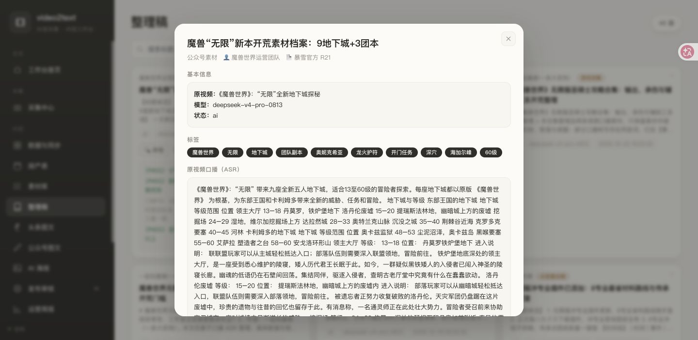
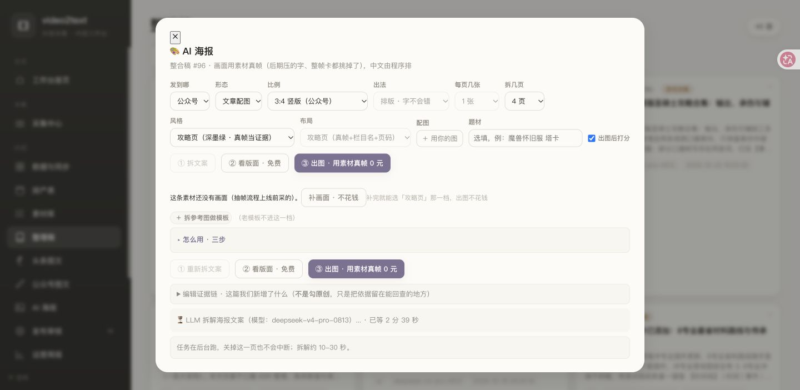
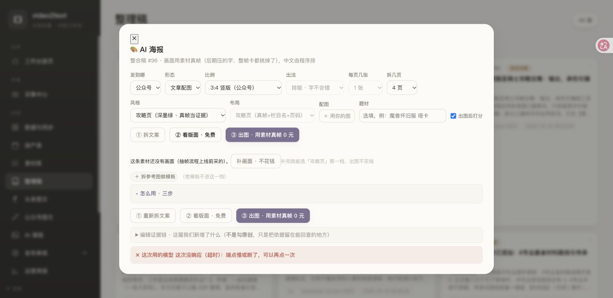

# 公众号图文试稿｜2026-10-24

状态：流程实测完成、文章样稿待审；未发布。主角色：wow-ops。目的：按「素材库线索 → 勾选素材 → 整合稿 → 拆文案 → 看版面」实走一篇，判断公众号文章能否交付。**本轮到拆文案时报模型超时，看版面无法继续，不能算全链路通过。**

> 2026-10-26 解释修正：这次实测选择了 AI 海报「公众号／文章配图」支线，拆文案超时只阻塞该支线，不阻塞人工核实并排版的公众号完整文章。公众号无需像头条号那样以多张海报加简短配文作为默认成品；当前形式见 `OPS-公众号当前策略-2026-10-25.md`。

## 素材与取舍

- 素材库「暴雪官方」筛出 21 条，选中《“无限”全新地下城探秘》（库内 ID 301198，2026-10-21）和《“无限”团队副本概览——位置、团队规模和开门任务》（ID 301197，2026-10-21）。两条均有正文和原文链接。[五人本原文](https://wow.blizzard.cn/news/24301455/index.html)、[团本原文](https://wow.blizzard.cn/news/24303009/index.html)。
- 曾试看「无限服冲专业插件已经添加！」：转写多处不通顺、关键帧未审核，因此不拿来支撑这篇稿。
- 这篇稿的增量是把分散在两篇公告中的信息按玩家的等级和开团时间重排，并标出唯一明确的个人入场前置；不抄公告的背景故事、开门任务长段落，也不声称本站实测。

## 可供站主审阅的文章样稿

**标题：无限服副本怎么安排？九座五人本到首批团本，先看这张时间表**

《魔兽世界》“无限”定于 11 月 5 日上线，官方公布了九座 13—60 级五人地下城；第一批三个 60 级团队副本定于 12 月 10 日开放。把两份公告放在一起看，准备顺序就清楚了：练级时按等级找五人本，满级后再按团队人数和开门条件安排团本。以下是**公告信息整理，不是游戏内实测路线**。

### 练级期：按等级看九座五人本

| 等级范围 | 五人地下城 | 位置 |
| --- | --- | --- |
| 13—18 | 领主大厅 | 丹莫罗，铁炉堡地下 |
| 15—20 | 洛丹伦废墟 | 提瑞斯法林地，幽暗城上方 |
| 24—29 | 挖掘场 | 湿地，维尔加挖掘场附近 |
| 28—33 | 达拉然城 | 奥特兰克山脉 |
| 35—40 | 沉没之城 | 荆棘谷近海 |
| 40—45 | 克罗多克要塞 | 河林 |
| 48—53 | 奥卡兹监狱 | 尘泥沼泽，奥卡兹岛 |
| 55—60 | 黑喉要塞 | 艾萨拉 |
| 58—60 | 塑造者之台 | 安戈洛环形山 |

这张表是**副本适用等级和位置索引**，不是最快升级顺序，也没有计算经验效率。想去达拉然城的玩家可以提前留意前置任务：公告写明，联盟从南海镇的大使雅克处接“紧急求援”；部落从塔伦米尔的大法师沃迪恩·伍德格莱尔处接“城市大门钥匙”和“入室偷窃”。实际任务文字与入口仍需上线后复核。

### 满级后：三个团本的人数不同

| 12 月 10 日计划开放 | 规模 | 已公布的位置或入口信息 |
| --- | --- | --- |
| 深穴 | 10 人 | 海加尔山，入口连通海加尔山、冬泉谷和黑喉要塞 |
| 海加尔峰 | 20 人 | 海加尔山之巅、世界之树附近 |
| 奥妮克希亚的巢穴 | 40 人 | 尘泥沼泽 |

这里的“10/20/40 人”是团队规模，不是难度排名；公告也没有给出本站可以据此推断的装备门槛。要和朋友组队，可以先确定你们想组织哪种规模，再看对应的入口与开放时间。

### 要提前安排的个人前置：龙火护符

官方明确写了：进入奥妮克希亚的巢穴前，**每一名成员都要取得并携带龙火护符**，不需要装备。联盟与部落各有一条任务链，最后都涉及黑石塔上层的黑龙勇士之血。40 人团不能只让团长做这一条；准备参加的每个人都要确认自己的任务进度。完整阵营步骤请点文末官方原文核对，本文不把十多步任务压缩成容易漏步骤的“速通攻略”。

这篇稿可以先收藏作开服前的时间和位置索引。等游戏上线并有实际截图后，我们再补入口画面和任务接取界面；数值、路线和入场条件若有调整，以游戏内与最新公告为准。

资料来源：[官方五人地下城公告](https://wow.blizzard.cn/news/24301455/index.html)（2026-10-21）；[官方团队副本公告](https://wow.blizzard.cn/news/24303009/index.html)（2026-10-21）。整理核对日期：2026-10-24。

## 配图与发布条件

这两条是官方文章素材，库内没有可供「关键帧」挑选的视频帧。样稿当前只能作为**带表格的文字文章**预览；不能为了填满图文而把公告图片当自有素材，或让 AI 重新画游戏画面。若要做多图版，应在游戏内自截入口/任务界面并逐张核对图的解释用途，或换成有清楚可用关键帧及授权依据的素材题目。文章发布前仍需人工核最新公告、游戏内名称与公众号排版。

## 流程实测记录

- 素材库中筛「暴雪官方」并勾选两条；生成类型设为「公众号文章素材」，模式「合并成一篇」。
- 页面确认弹窗在 Chrome 控制接口卡住；检查 `/api/status` 未启动后，按页面原参数调用同一个 `/api/content/generate` 接口。约数分钟后生成整合稿 **ID 96**，模型 `deepseek-v4-pro-0813`，来源 ID 正确回存为 301198、301197。
- 整理稿「体检」显示**可以发**：七节齐、27 个数字可回指、3 条摘录与原文重合度超过 50%。这只证明格式和文本匹配，不证明可发。人工复核发现：把官方文章误称「视频／口播转写」；把官方原文里的「龙形护符」标为疑似错字；说素材未标年份却没有用原文日期与上线公告核对；整段摘取官方金句，不构成本站表达。此稿**不能直接发布**。

- 在整理稿点「AI 海报」，设渠道「公众号」、形态「文章配图」、比例自动切 3:4、页数 4，点击「① 拆文案」。页面同时提示「这条素材还没有画面（抽帧流程上线前采的）」并给「补画面」按钮；实际选中的是官方**文章**而非视频，该按钮不适用于本题。`/api/poster/frames?summary_id=96` 实测两条素材均 `total=0、usable=0`。
- 拆文案调用运行约 10 分钟后返回「模型没响应（超时）」。`/api/poster/status` 为 `done=true, stage=plan, error=...超时`，没有 plan；随后点「② 看版面」也没有得到可预览的页面。未点「③ 出图」，未上传公众号。

## 实测判断与交接

这套流程**能把真实素材合并成一份可供编辑的线索档案，不能按现状一键交付一篇准确、带真实图的公众号文章**。我按原文核过的上方样稿可作为人工待审文字稿；两条官方文章没有视频关键帧，因此本题不适合强行走「真帧攻略页」。需要出图时，应换有可审核关键帧的素材，或待上线后用自己截的游戏界面解释文章中的入口和任务步骤。

给下一轮 Qoder 的具体修复点：① 素材源类型从库中保留到提示词和页面，官方文章不得再被称为 ASR/口播，独立任务物品不能凭名称相似猜为错字；② 在拆文案前提供可编辑的事实核查稿和真正的人工通过状态，机检“可以发”应限定为结构检查；③ 非视频素材不显示「重新下载视频／补抽帧」，允许走文字文章或上传本站真实截图；④ 拆文案超时要有可选快速模型或清晰失败回退，并保留原稿供续做。以上是本轮实测暴露的问题，未在 video2text 改代码。

