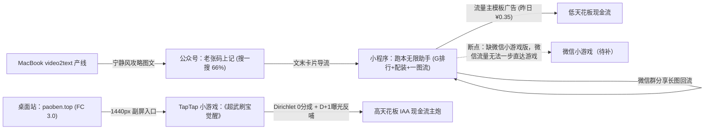

# 个人开发者资产闭环、架构成本与决策建议（2026-11-25）

> **背景同步（2026-11-25 站主口述）**：
> - 小程序「跑本无限助手」已接入「区服 G 排行（仅供参考）」与流量主，昨日广告收入升至 **0.35 元**（较 11-23 的 0.02 元增长 17.5 倍）；
> - 小游戏 TapTap《超武刷宝觉醒》正在补齐资料与办理软件著作权；
> - `video2text` 已修复抓取订阅失败问题，正在稳定产出宁静风图文发布公众号「老张码上记」，预计本周五（11-27）同步近几日运营数据；
> - Web 站 `paoben.top` 近期暂不投入日常精力，后续择机同步数据。

---

## 一、闭环诊断：目前是一个完整闭环吗？

**结论：已经跑通了 70% 的「内容生产 → 搜一搜获客 → 高频工具留存 → 轻广告变现」雏形闭环，但尚未形成「高 ARPU 复利闭环」，存在 3 个断点。**

1. **已跑通的正反馈**：
   - `video2text → 公众号搜一搜` 的低边际成本生产链路已打通；
   - 小程序通过「区服 G 排行」把低频查资料补成了高频日看刚需，广告收入立即放大；
   - 「团长开荒一图流 / 喊人图」补上了微信群裂变回流机制。
2. **核心 3 个断点**：
   - **断点 1（最关键）**：公众号与小程序积累的微信端玩家，目前只能变现低 eCPM 的工具页广告，无法在微信生态内一步跳转至高 eCPM 的《超武刷宝觉醒》（TapTap 链接在微信内损耗极大）；
   - **断点 2（风控与手工成本）**：「区服 G 排行」依赖手工/半自动录入且带个人主体合规敏感度，需坚持 `grank` 远程开关可控、零外链原则；
   - **断点 3（多线维护分散）**：Web 站 `paoben.top` 仍靠手动进 FC 控制台传包，占用个人开发者稀缺注意力。

---

## 二、技术架构与成本评估：OSS 是最优解吗？要不要开云函数和数据库？

### 1. OSS 静态分片架构：当前阶段的最优解（无需推倒重来）
- **真实存储账单**：素材约 9.9 MB + 数据批次约 3 MB/批，总占用 < 0.2 GB，标准存储费 **≈ 0.02 元/月**。
- **真实流量账单**：因客户端已实现 `buildId` 强缓存（命中同批仅拉取 11 KB `manifest.json`），人均日耗下行 < 0.3 MB：
  - `100 DAU`：≈ 0.9 GB/月 → **≈ 0.45 元/月**
  - `1,000 DAU`：≈ 9 GB/月 → **≈ 4.5 元/月**
  - `10,000 DAU`：≈ 90 GB/月 → 接 CDN 后 **≈ 20 元/月**（此时广告月收入远超流量费）。
- **隐性红利**：零服务器运维、零宕机风险、零数据库注入与连接池事故、零固定月租。

### 2. 是否需要开通云函数与数据库？
- **现阶段结论：坚决不开（DAU < 5,000 且无 UGC/账号系统前属于纯负 ROI）。**
- 微信云开发基础月套餐约 **19.9 元/月起**、独立云数据库 **30–80 元/月起**；在当前小程序日入 0.35 元（≈ 10.5 元/月）阶段，开通即刻由「正毛利」转为「倒贴固定成本 + 多维护一套后端」。
- **明确触发阈值（达到以下任一条件再考虑）**：
  1. 需要用户跨设备存档/实时写数据（注：未来小游戏排行榜与云存档优先用 TapTap / 微信小游戏**平台自带免费能力**，仍无需自建数据库）；
  2. OSS 月下行超过 100 GB（约 1 万 DAU）→ 此时仅需在 OSS 前套一层 **CDN + 流量包**，仍不需改服务端。

### 3. 当前架构最值得做的 3 项零月租微优化（按优先级）
1. **【P0 必做】把 `g-rank.json` 独立出 `builds/{buildId}` 大批次（参照 `flags.json` 热更模式）**：
   - **痛点**：现在每更新一次 G 排行都要重发整批、换 `buildId`，导致全体老用户本地 176 个分片缓存全部失效重下，既慢又浪费 OSS 流量；
   - **改法**：把 `g-rank.json` 放到独立路径 `wow/beta/v1/g-rank.json`（1–2 KB，`Cache-Control: max-age=300`），单独 PUT 1 秒生效，**省掉 95%+ 无效 OSS 流量费**。
2. **【P1 顺手】清理 `wow/beta/v1/builds/` 历史旧批次**：当前 `builds/` 下已堆积上千个旧对象，保留最近 3–5 批即可（或配 OSS 生命周期），减少管理噪音与存储冗余。
3. **【P2 延后】给 `paoben.top` 配一键部署脚本并盯紧 FC 资源包到期**：用 Serverless Devs (`s deploy`) 或 FC API 取代手工传 ZIP，并留意杭州 `paoben-web` 的 CU 资源包余额与到期日，避免过期按量扣费。

---

## 三、作为个人开发者的改进与商业发散决策建议

### 决策 1：主线聚焦「一炮 + 一井 + 一鱼双吃」
- **现金流主炮（70% 精力）**：死磕《超武刷宝觉醒》软著与上架。**关键发散：用同一套 Cocos 3.8.7 工程 + 同一个电子软著，同步上架「TapTap 小游戏 + 微信小游戏」**。
  - TapTap 吃 Dirichlet 0 分成 + D+1 首页曝光反哺；
  - 微信小游戏承接公众号「老张码上记」与小程序「跑本无限助手」的存量玩家，**把微信生态的免费搜一搜流量直接转化为高 eCPM 激励视频收入**，真正闭合商业大环。
- **流量蓄水池（30% 精力）**：公众号 `video2text` 宁静风稳定更新 + 小程序维持现状不加新大页面。
- **冻结项**：`paoben.top` Web 站近期不再投入研发时间，仅在 12 月 10 日团本开放等大节点同步一次数据。

### 决策 2：周五公众号数据复盘的 3 个硬指标
周五拿到近几日数据后，直接按指标做「留强去弱」：
1. **搜一搜入口占比**（看选题关键词是否命中玩家真实搜索）；
2. **分享率**（>5% 即证明可复制为系列模板，避免同题重发）；
3. **文末小程序直链点击转化**（将文章精准链到对应子页：如 60 级团前文链 `pages/bis/index?stage=60`、物价/打金文链首页 G 排行）。

### 决策 3：小程序广告位克制提效 + 主体风控底线
- 在不赶客前提下，优先评估「G 排行下方 / 详情页中部原生模板」与「生成分享长图返回后的低频插屏（每用户每日限 1–2 次）」，放大单 UV 收益；
- **主体合规红线**：G 排行严格坚持 `grank` 远程可秒关、零外链、零交易引导；切勿因衍生工具短期几毛钱广告触发主体违规，确保同一自然人名下的原创小游戏与公众号安全。

---

## 四、状态与下一步
- **状态**：`已定（架构与商业闭环评估落盘）／待用户确认（是否优先落地 g-rank.json 独立热更以省 OSS 流量；周五同步公众号数据后复盘选题与广告位）`
