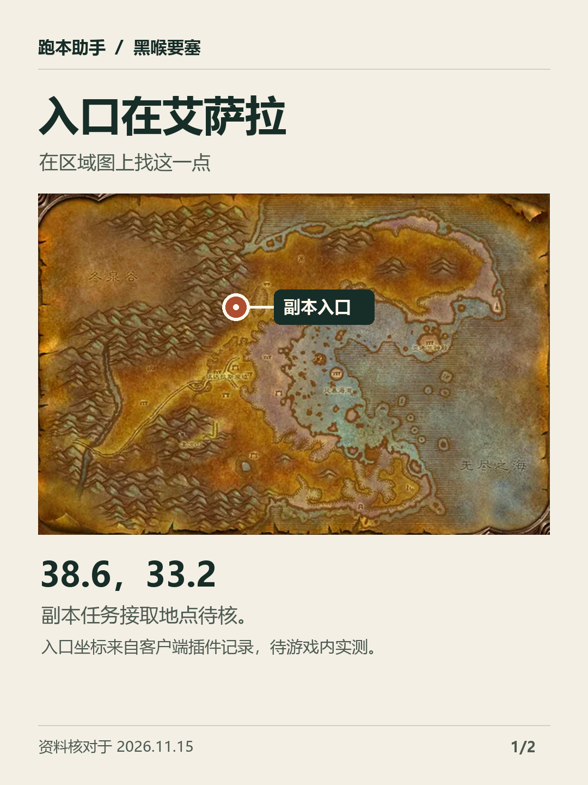
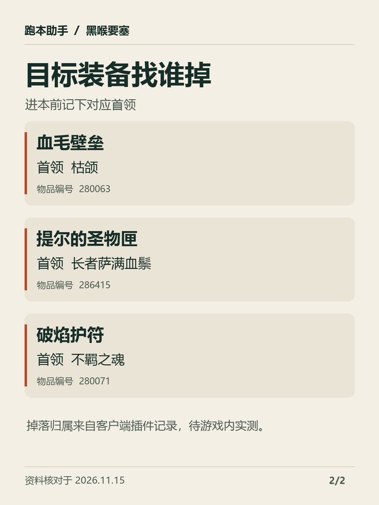

# 黑喉要塞怎么进？三件装备找谁掉

去黑喉要塞，先在**艾萨拉 38.6，33.2**找入口。如果你是奔着某件装备去的，进本前先记下对应首领。

## 进本前查一下目标装备

| 要找的装备 | 对应首领 | 物品编号 |
| --- | --- | --- |
| 血毛壁垒 | 枯颌 | 280063 |
| 提尔的圣物匣 | 长者萨满血鬃 | 286415 |
| 破焰护符 | 不羁之魂 | 280071 |

副本任务的接取地点目前待核。有任务在身时，进组前可以先核对任务日志里的目标。其他装备可在[黑喉要塞副本详情](https://eplayed.github.io/wuxian-atlas/#/dungeon?id=blackmaw-hold)里展开首领掉落查询。

入口和掉落归属根据 2026 年 11 月 15 日核过的 DungeonsForever 2.1.96 数据整理，待游戏内实测。[数据来源](https://wx-wow.com/changelog.html)

发布前编辑记录

- 第 1 图坐标来自 Forever 的副本入口数据。艾萨拉底图为本站留存的客户端区域图，定位点为本站标记。
- 第 2 图逐行对照黑喉要塞的掉落成品，按物品与首领 ID 匹配。
- 任务数据当前无可定位的接取记录。文案保留这一状态。
- 本稿供校对和渠道对照。整理完成后由号主审阅发出。

