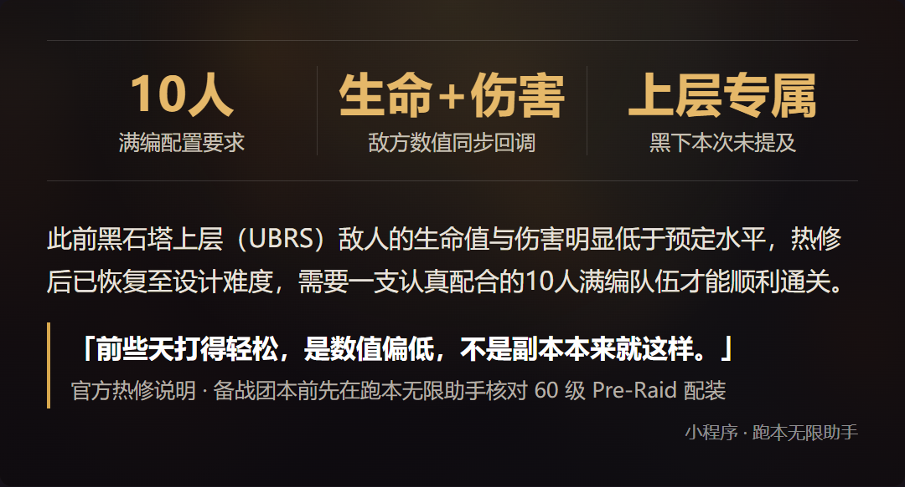
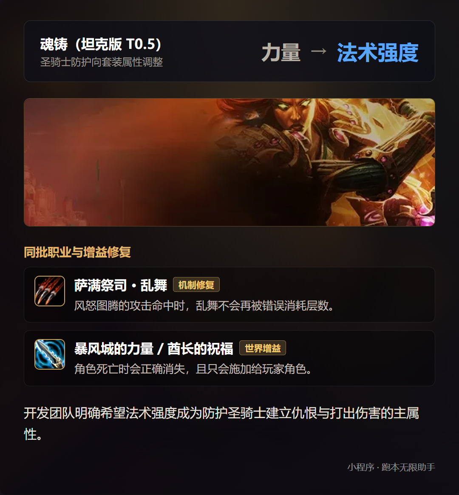
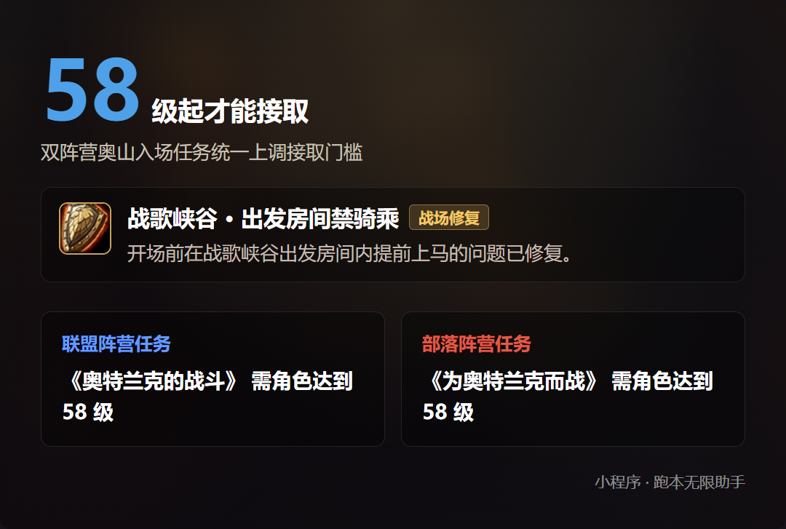
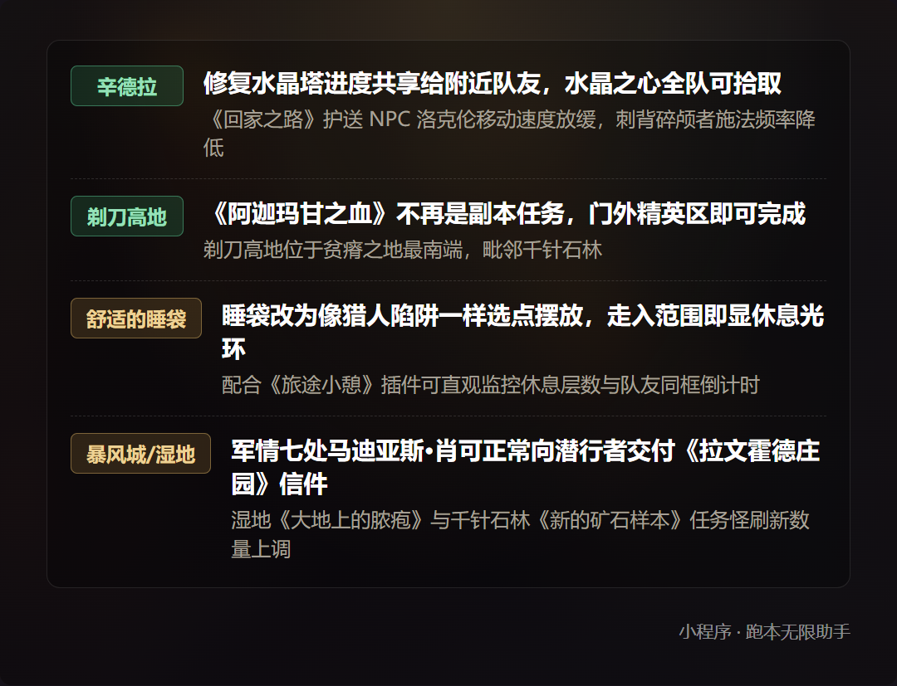
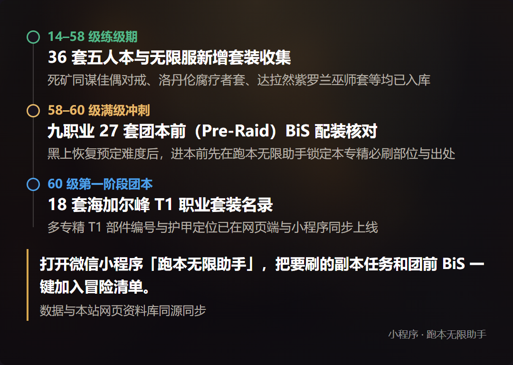

# 11.17热修：黑上恢复预定难度，防骑魂铸套改加法强

> 黑石塔上层恢复了原本的 10 人满编难度，防骑 T0.5 魂铸套由力量改为法术强度；辛德拉任务共享进度，睡袋也改成了选点摆放。

## 黑石塔上层，恢复预定难度

此前**黑石塔上层**敌人的生命值和伤害都明显低于预定水平，这次热修一并回调。蓝帖明确提到，现在又需要一支认真配合的 !!10人满编队伍!! 才能顺利通关，具体上调幅度未公布，黑石塔下层本次没有提及。

对于刚满 !!60级!! 准备刷雷德双刀、石楠之环或各职业 **团本前（Pre-Raid）BiS** 的玩家来说，进本前建议先组齐标准配置。

## 防骑的魂铸套，力量换成了法术强度

坦克版 T0.5 **「魂铸」**套装原来提供的力量属性，在本次热修中正式改为了**法术强度**。开发团队解释，希望让法术强度成为防护圣骑士制造伤害与仇恨的主要属性。

另外还有两条职业与增益修复：风怒图腾命中时，萨满祭司的**乱舞**不会再误掉层数；**暴风城的力量**与**酋长的祝福**在角色死亡时会正确消失，且只会施加给玩家角色。

## 奥特兰克山谷，阵营任务要 58 级才能接

奥山两边的阵营入场任务——联盟《奥特兰克的战斗》与部落《为奥特兰克而战》，现在统一调整为 @@58级@@ 才能接取。同时，战歌峡谷开场前在出发房间里提前骑上坐骑的问题也已修复。

## 辛德拉的水晶塔、睡袋摆放与世界任务优化

辛德拉声望与任务体验轻松了不少：**修复水晶塔**的进度现在会共享给附近队友，**水晶之心**任务掉落全队每个人都能拾取；剃刀高地的《阿迦玛甘之血》也不再要求进副本，门外精英区就能做完。

备受练级玩家好评的**舒适的睡袋**，现在改成了像猎人陷阱一样**选点摆放**，走进范围就会出现休息光环。

## 备战满级与团本：跑本无限助手已同步 27 套团前 BiS

随着黑上难度回归与满级玩家增多，本站与「跑本无限助手」小程序已同步更新 !!36套!! 14–58 级练级套装、九职业 !!27套!! 60 级团前 Pre-Raid BiS（共 !!422件!! 装备中文出处）以及 !!18套!! 海加尔峰 T1 名录，方便进本前随手核对。

