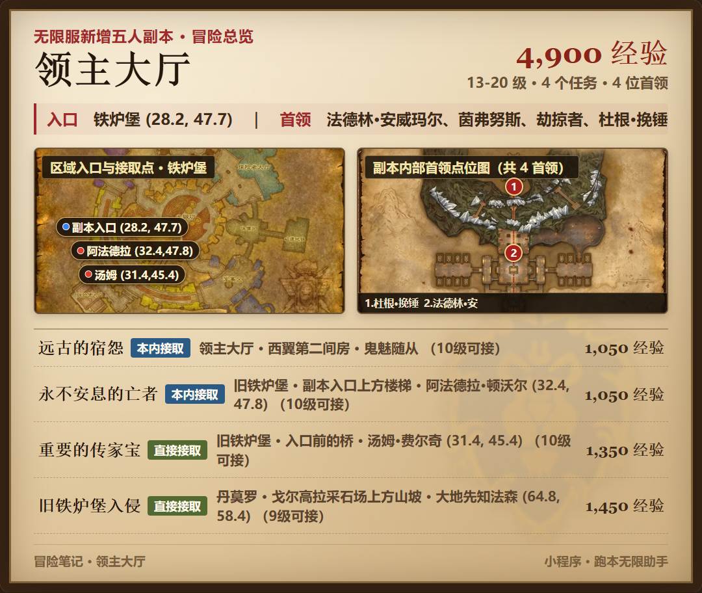
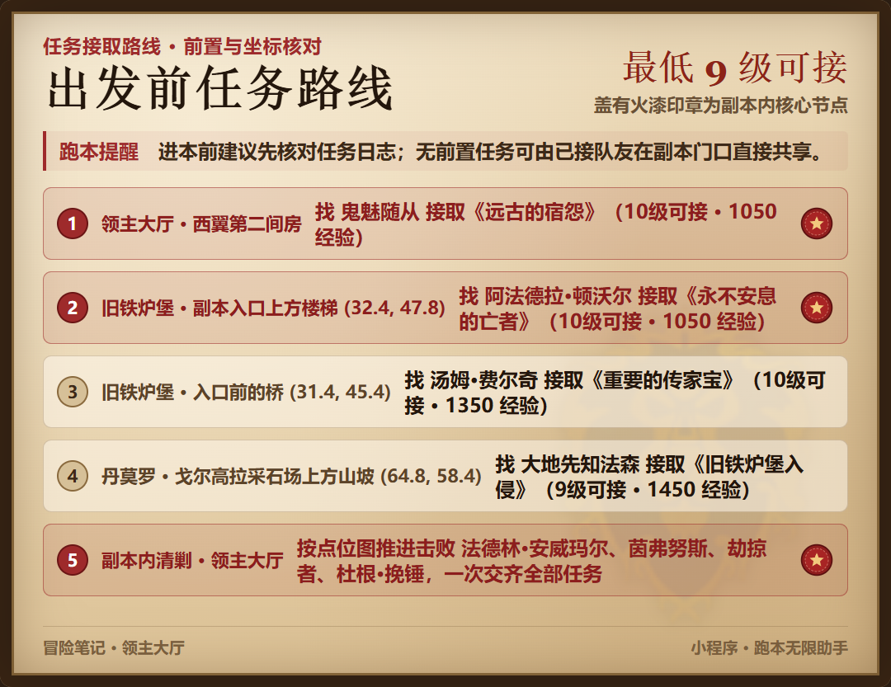
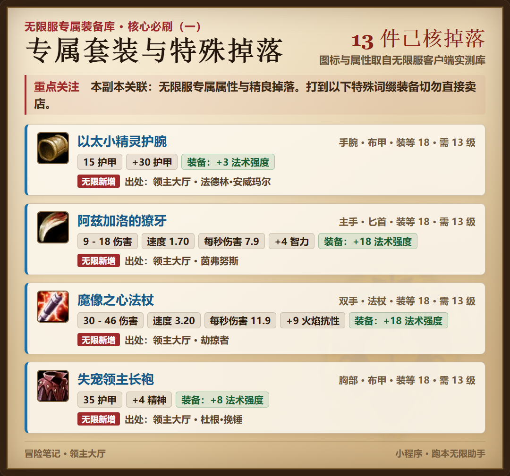
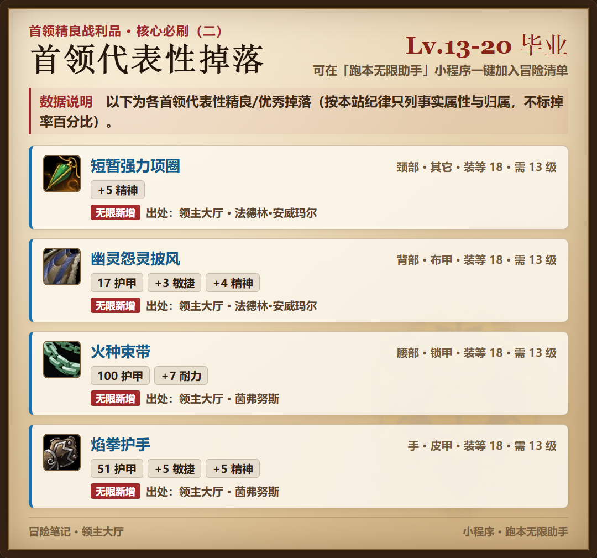

# 无限冒险笔记｜领主大厅副本任务与专属掉落全指南

> 一趟拿满 4,900 任务经验，顺手刷齐无限服新增套装与特殊掉落——出发前先把这份手账翻一遍。

## 进本之前，先看清这 4 个任务的来处

**领主大厅**位于丹莫罗，铁炉堡地下（入口坐标 !!铁炉堡 (28.2, 47.7)!!），推荐等级 !!13-20级!!，副本内共有 !!4位首领!!与 !!4个关联任务!!。

如果把这 !!4个任务!!在进本前全部接齐，一趟下来仅任务结算就能拿到约 !!4,900点经验!!，还不含沿途精英怪与首领的额外产出。

## 接取路线与前置要求：哪些必须提前做？

很多队伍进本后才发现有人接不到共享任务——原因通常是卡在了**前置任务链**或**最低接取等级（9级）**。

出发前请对照下方路线图与坐标逐一检查任务日志；盖有**红色火漆印章**的步骤为进入**领主大厅**后的核心交付节点。

## 无限服专属新增套装与特殊掉落

与传统旧世不同，无限服在**领主大厅**里塞进了多件极具实用价值的**专属套装与特殊词缀装备**（含 无限服专属属性与精良掉落）。

下面这些装备的图标、护甲与绿字特效均已由本站从无限服客户端与实测库逐条核对，刷到后千万别顺手卖了商店。

## 首领核心战利品与跑本常见问题

除了特殊功能装，**领主大厅**各首领还出产多件 !!13-20级!! 阶段极其扎实的过渡蓝绿装。你可以打开「跑本无限助手」小程序，把目标装备一键加进自己的**冒险清单**。

