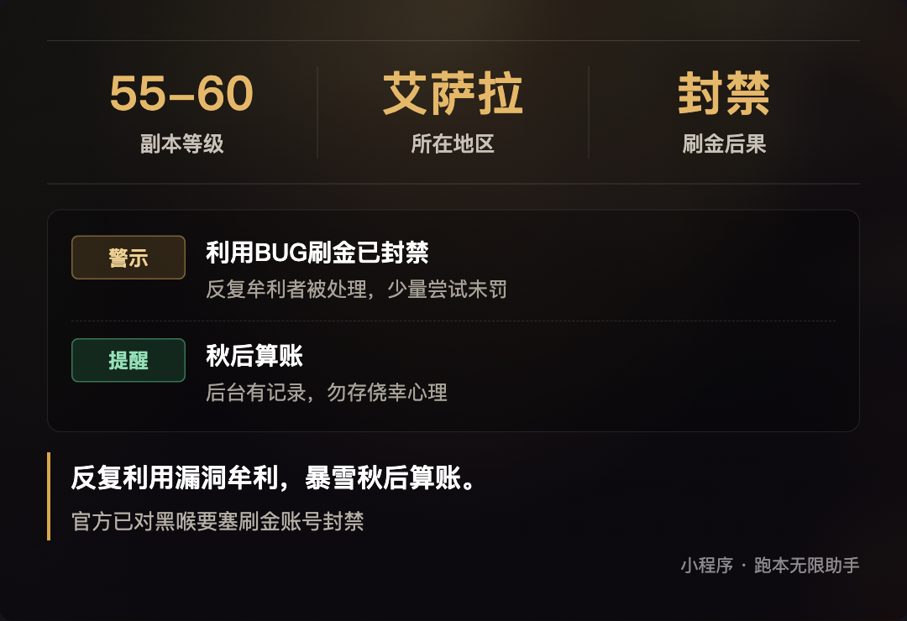
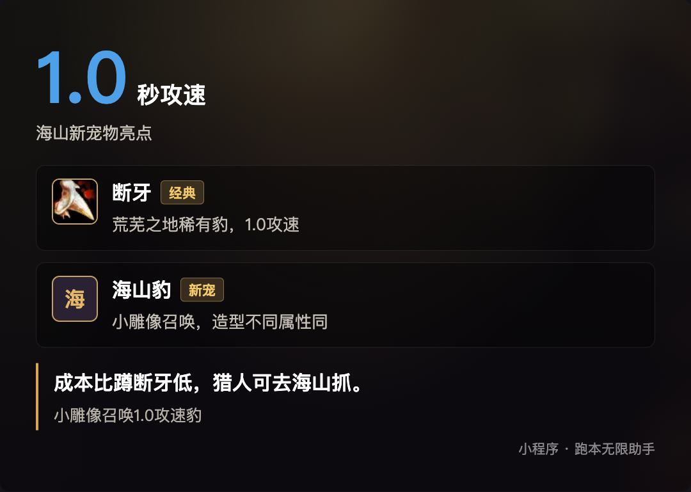
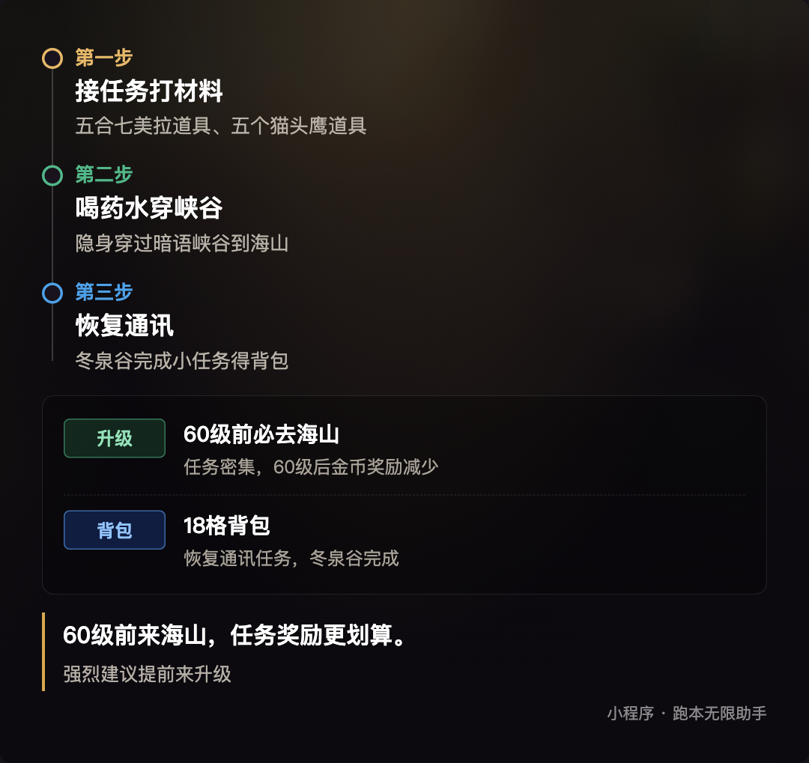
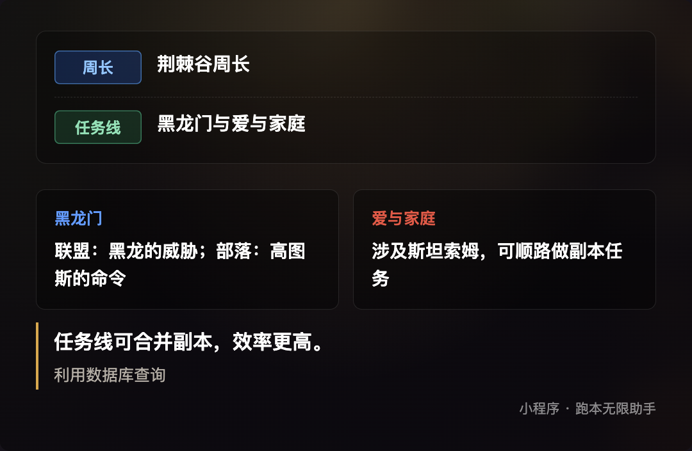
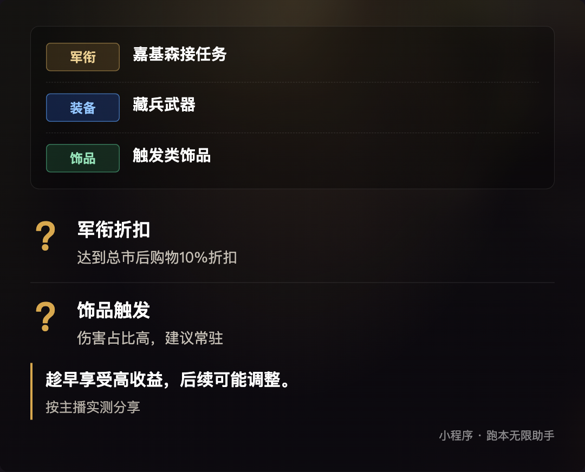

# 57-60级必做清单！海山1.0攻速宝宝与封禁警示

> 57-60级关键期，海加尔山1.0攻速宠物、18格背包、周长与军衔任务，还有黑喉要塞封禁警示，一篇理清。

## 黑喉要塞封禁警示

官方已对利用**黑喉要塞**BUG刷金的账号进行封禁。该副本位于**艾萨拉**，推荐等级**!!55-60!!**级。部分玩家只刷几次未受处理，但反复牟利者已被**秋后算账**。

游戏内仍存在其他漏洞，利用BUG牟利风险极高，建议玩家**自觉抵制**，避免账号受损。

## 海山1.0攻速宠物

海加尔山出现**1.0攻速**宠物，通过开启小雕像召唤，造型与经典**断牙**不同，但属性一致。断牙位于**荒芜之地**，蹲守成本高，海山宠物获取相对容易。

猎人玩家若追求**1.0攻速**，可前往海加尔山寻找，成本比蹲守断牙**低很多**。

## 升级路线与背包

强烈建议**!!60级!!**前前往**海加尔山**升级，任务密集且奖励金币，60级后部分任务金币奖励减少。入门怪等级**!!50-57!!**级，适合过渡。

海山可获取**18格背包**，通过完成“恢复通讯”任务，需前往**冬泉谷**完成小任务后返回交还。

## 周长与任务线

**!!60级!!**后可在**荆棘谷**接取周长任务，奖励看运气。同时可完成**黑龙门**与**爱与家庭**任务线，利用数据库查询任务步骤，顺路完成相关副本任务。

合理安排任务线，可同时完成**黑下、黑上、斯坦索姆**等副本任务，提升效率。

## 军衔与装备收益

满级后可刷**军衔**，在**嘉基森**接取“荣誉之地”系列任务，完成战歌峡谷目标。军衔达到总市后购物有**!!10%!!**折扣，可与声望折扣叠加。

装备方面，**藏兵武器**通过**塑源者平台**任务获取，属性优秀。另有触发类饰品，按主播实测分享，伤害占比高，**疑似触发概率上调**，建议常驻。

