# 魔兽无限服9职业练级天赋：防战拉7怪，近战兽王

> 九大职业27天赋洗牌，猎人近战兽王、战士防战封神，练级效率翻倍。

## 猎人：近战兽王称王

猎人练级唯一答案是**近战兽王猎**。放弃纯远程输出，装备双手武器或双持附魔灼热的单手剑/匕首，战斗时保持野兽守护，挂毒蛇钉刺后直接冲上去肉搏，人宠合一协同爆发极其夸张，低等级也能轻松割草。

只有偶遇灼热弓等极品远程武器时才值得切回远程过渡。

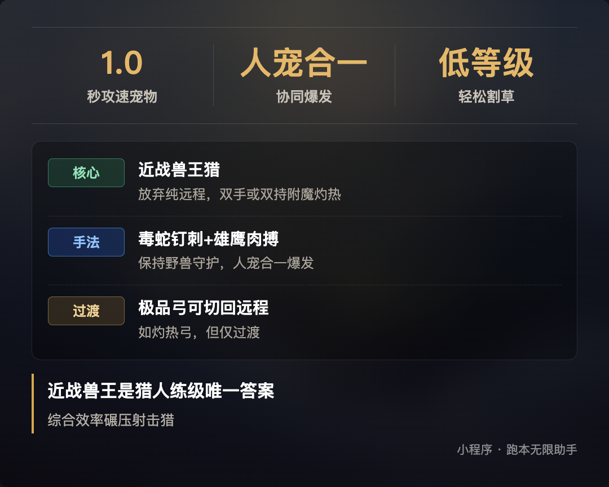

## 战士：防战封神

暴雪彻底改写了战士练级历史，**防护战士**成为最安全安逸的练级机器。点出强化复仇和防御大师，每次躲闪或招架都能白嫖怒气，配合遗产天赋无限回复，野外能同时抗住!!6-7!!个怪，全程不用坐地板。

操作极简，把复仇、盾牌格挡、盾牌猛击绑进一个宏无脑按，副本秒进组还能打输出第一。

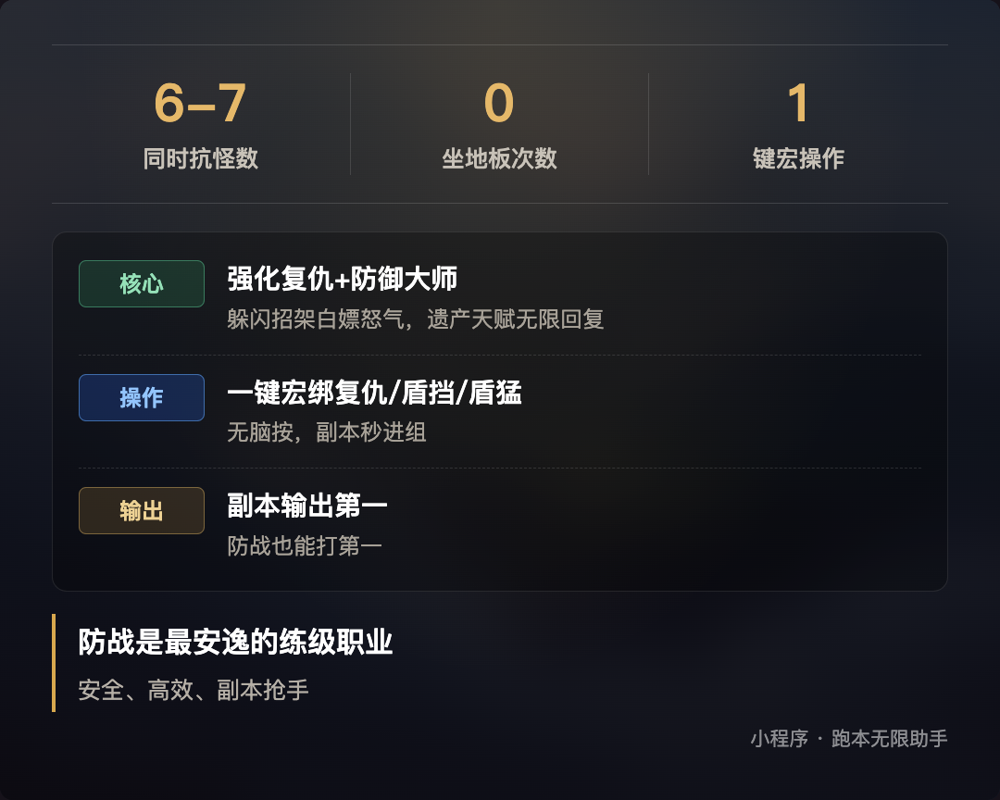

## 圣骑士：40级转防骑

1-40级走**惩戒骑**，点出正义追击加移速；40级后立刻洗**防护圣骑士**，去拍卖行淘法伤绿装，给盾牌装盾刺，点出神圣之盾和以盾为是，几乎无休息时间。

防骑还能把透明治疗药水当水喝，用纯净术驱散疾病负面，续航能力拉满。

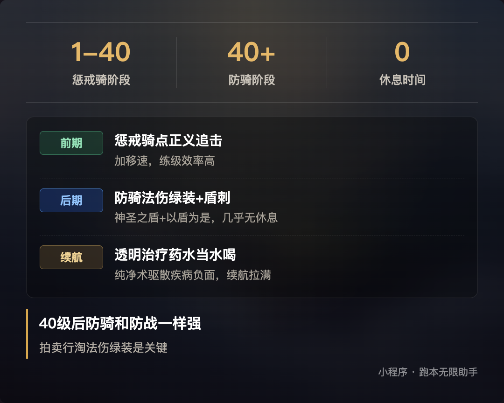

## 盗贼：战斗贼最稳

盗贼唯一答案是**战斗贼**。拥有全专精最强AOE，每!!2!!分钟一次的剑刃乱舞轻松应对多怪，疾跑和闪避冷却缩短!!60%!!大幅提升容错。

核心神技还击不占公共冷却且只需!!10!!点能量，招架后白打一发高伤害，绑进邪恶攻击宏里白嫖输出。

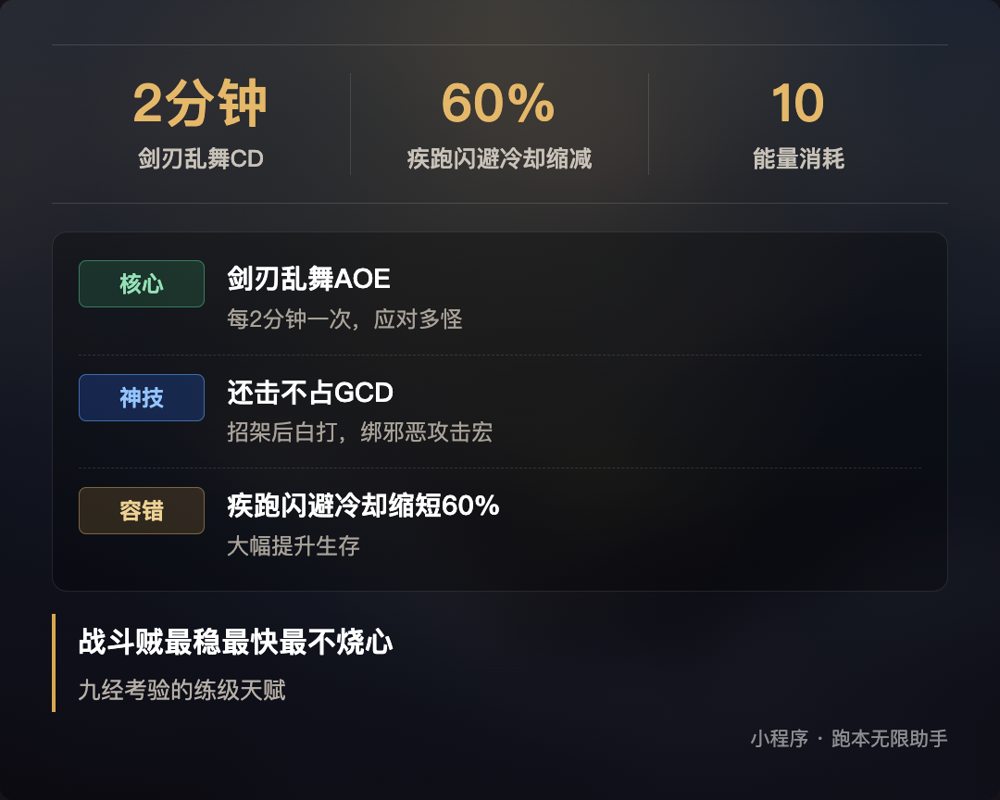

## 德鲁伊：野德猫形态

平衡德杀一只怪要!!18-20!!秒，节奏太慢；穿敏捷耐力装的**野德猫形态**杀怪只需!!8-10!!秒，效率翻倍。

野外精英任务轻松单刷，急需进本时切熊形态客串坦克秒进组。

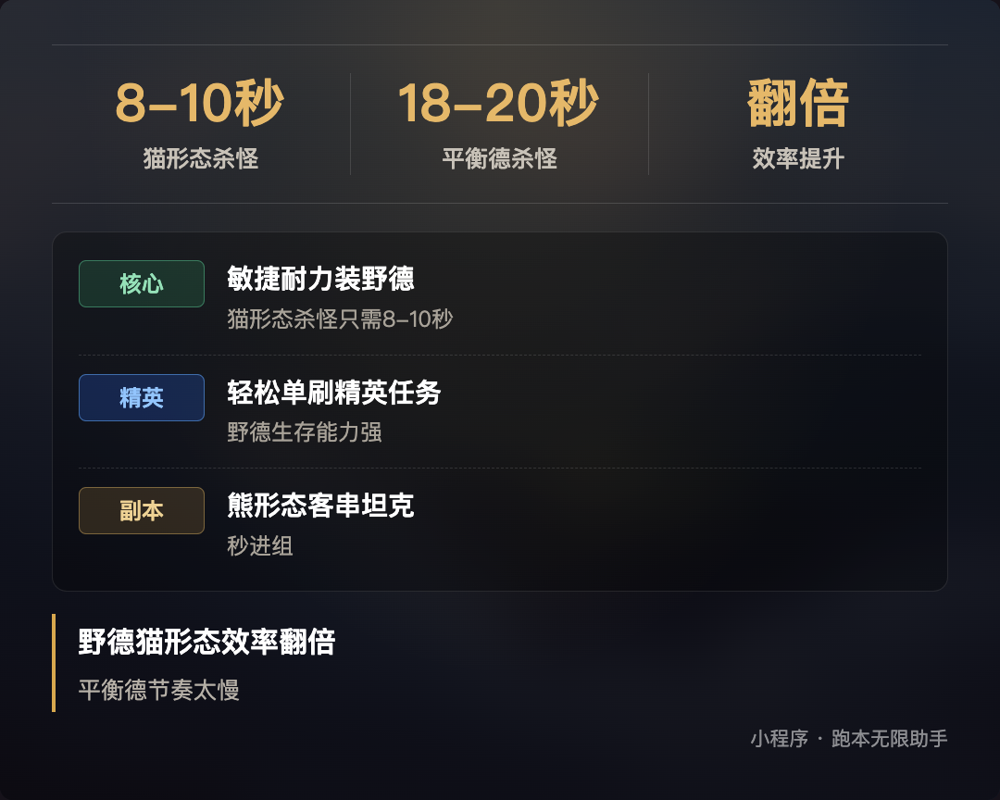

## 萨满：增强萨唯一真神

萨满练级唯一答案是**增强萨**，千万别碰元素萨，否则大半青春浪费在坐地板喝水上。

增强萨有无数极品双手武器支撑，打击感与效率兼备，甚至可用增强坦克天赋拿双手武器练级，背包常备治疗装随时客串治疗秒进副本。

- **治疗药水**（装等 22 · 售价 75铜）
  - `使用：恢复280到360点生命值。（2分钟冷却）`

- **透明治疗药水**（装等 22 · 售价 75铜）
  - `使用： 立即恢复600到680点生命值，但你会逐渐失去治疗量的75%。 该效果的症状可能体现为持续6秒的中毒或12秒的疾病。 (2分钟冷却时间)`

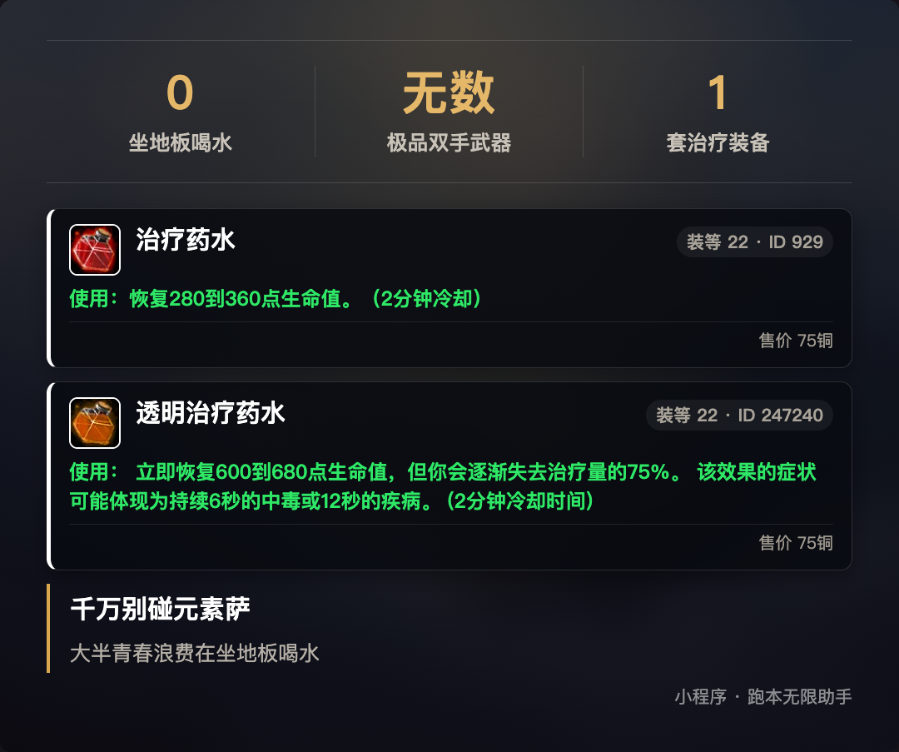

## 法师：奥法爆发最猛

法师三系练级都不弱，但公认练级速度最快、爆发最猛的是**奥法**。奥法可以清晰蓝条瞬间融化单体目标，蓝耗控制优秀，群拉AOE更是天花板级别。

冰法稳健但效率不如奥法。

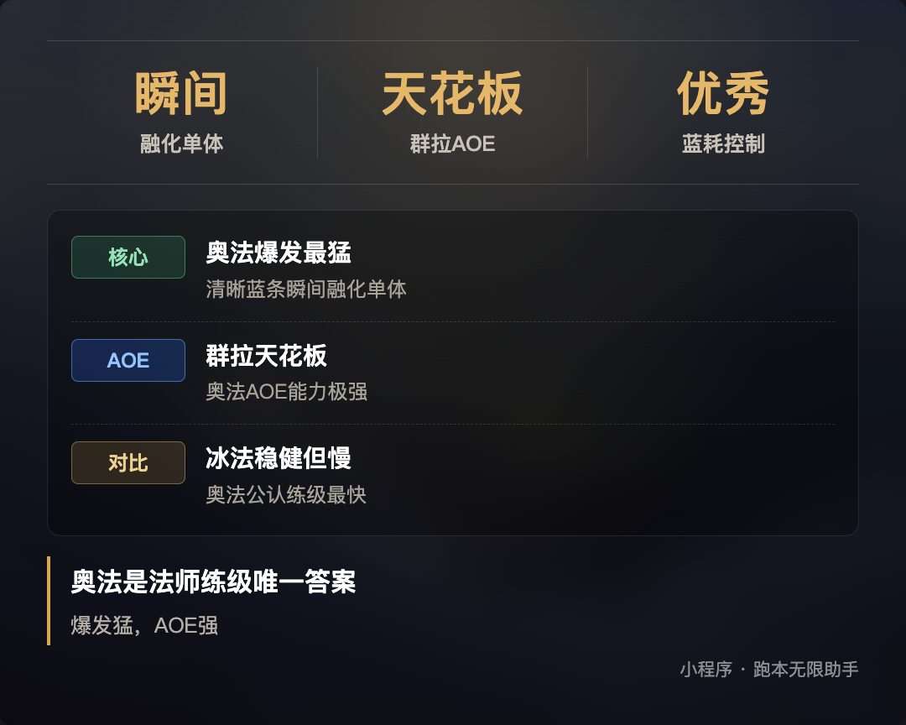

## 术士：痛苦或恶魔

追求急速选**痛苦术**，依靠生命虹吸、痛苦灾祸加快持续伤害跳伤频率，配合暗影掌握增伤，吸取生命和生命分流无限循环，拉怪之间零休息，像永动机一样。

追求安逸选**恶魔术**，尤其在PVP服务器，宠物扛怪让你永远满血，随时最佳迎战状态。千万别玩毁灭术，装备凑不出法伤纯属折磨。

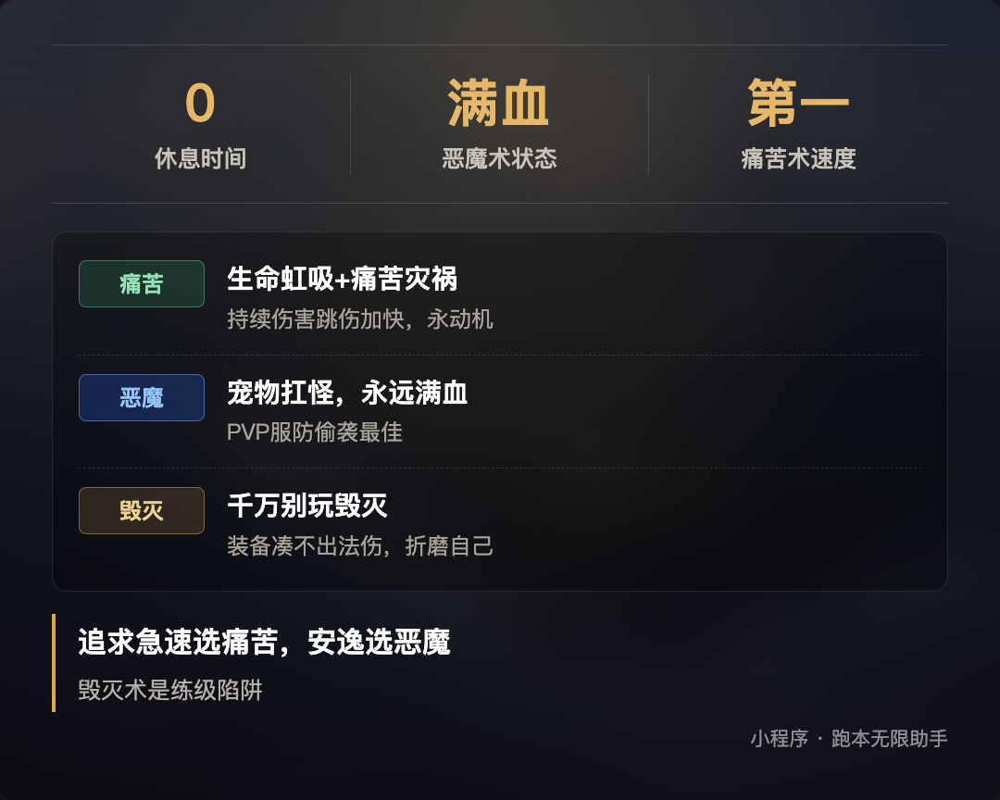

## 牧师：40级后暗牧

牧师练级唯一答案是**40级后暗影牧师**。虽然暴雪在11月16日把吸血鬼的拥抱小队治疗效果从!!20%!!砍到!!10%!!，但暗牧野外单刷王者的地位丝毫未动摇。

1-40级过渡期走戒律路线，点出苦修和冥想回蓝，配合暗影系精神分流用魔杖平稳推进；40级后切暗影形态一路平推，同时开启双天赋背治疗专精，野外单刷副本秒进两不误。

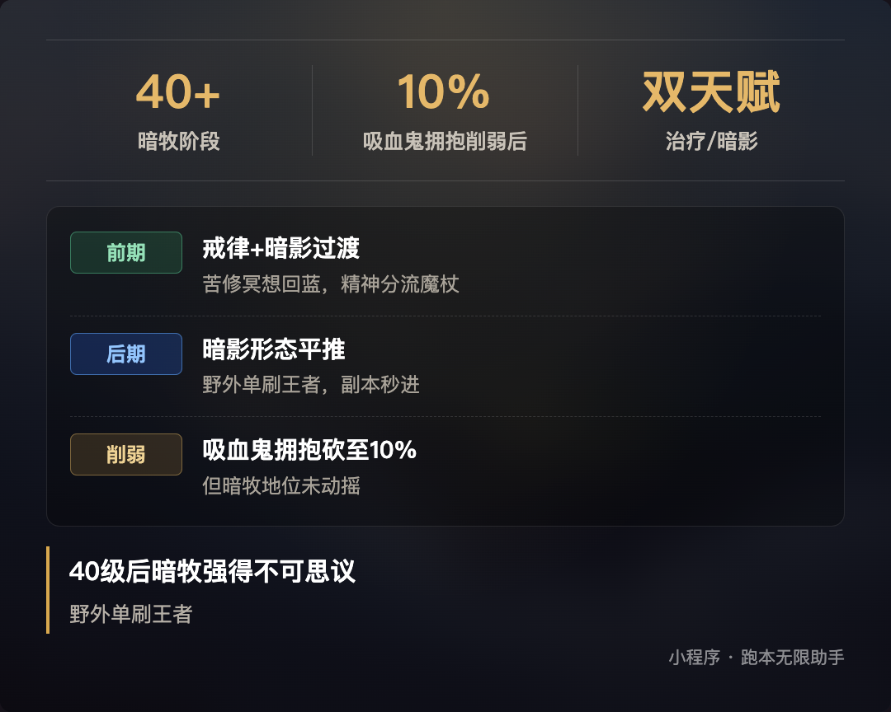

## 推荐天赋加点（模拟器实图）

- **战士**：武器 4 / 狂怒 16 / 防护 31（`?c=warrior&p=01300000000000000-0505000501000000000-050033120331001351`）

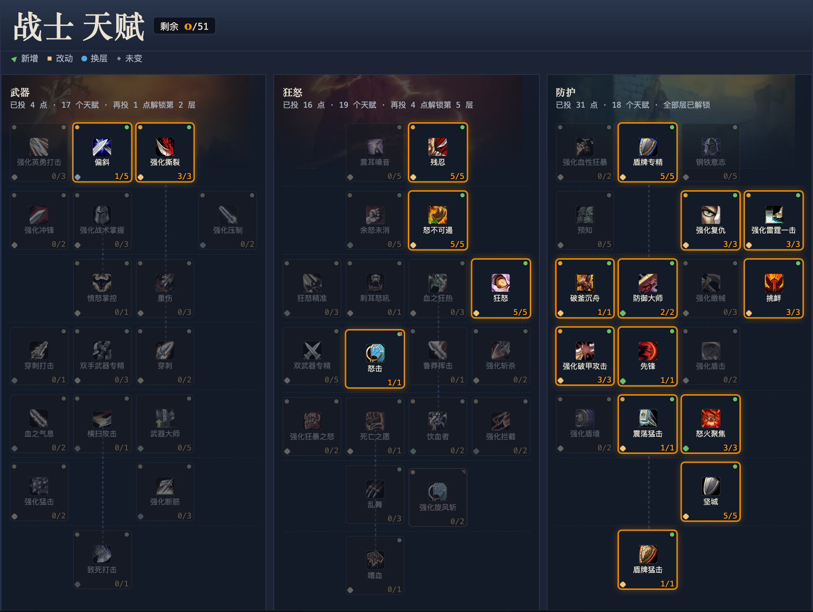

- **牧师**：戒律 13 / 神圣 3 / 暗影 35（`?c=priest&p=025003000030000000-30000000000000000-30542001251312051`）

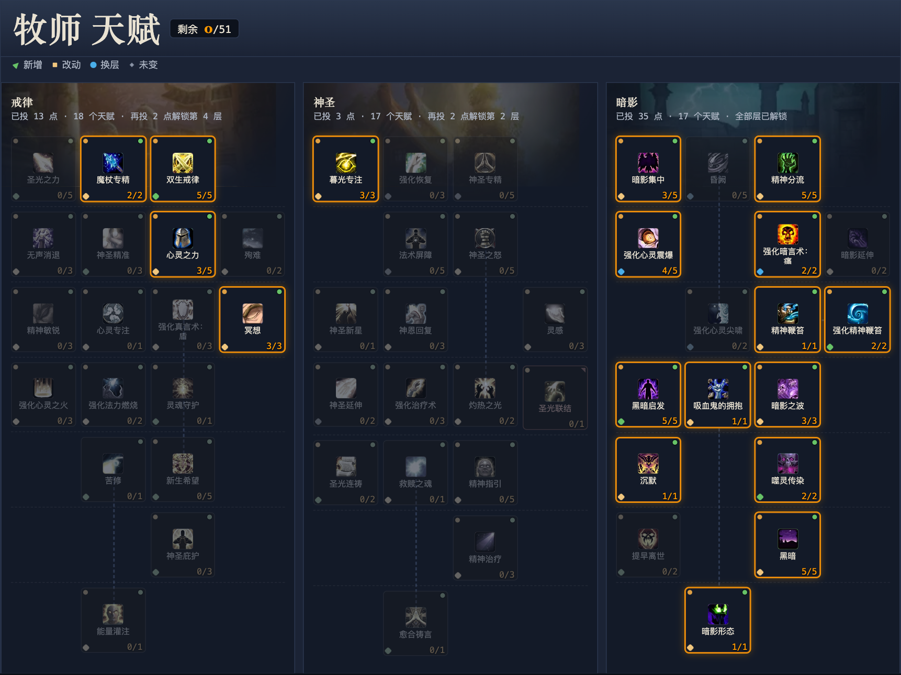
