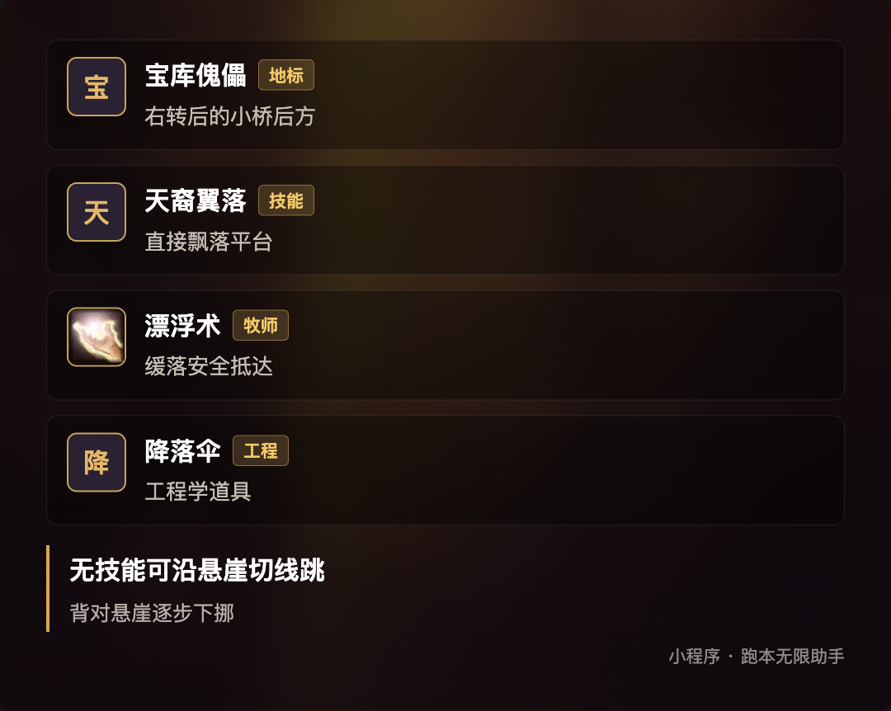
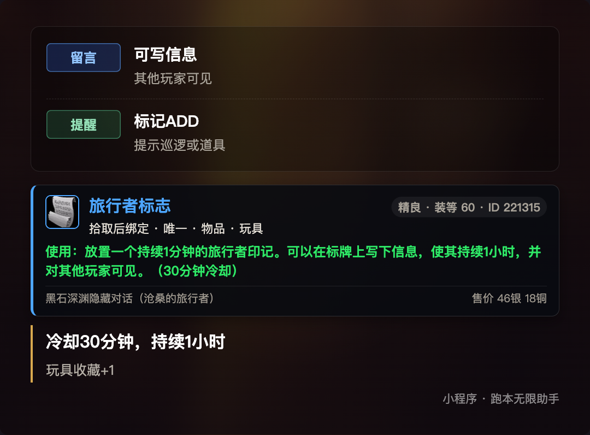
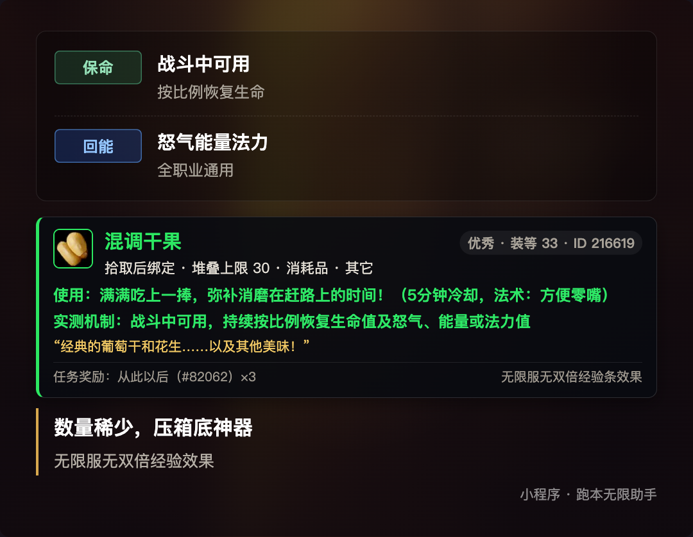
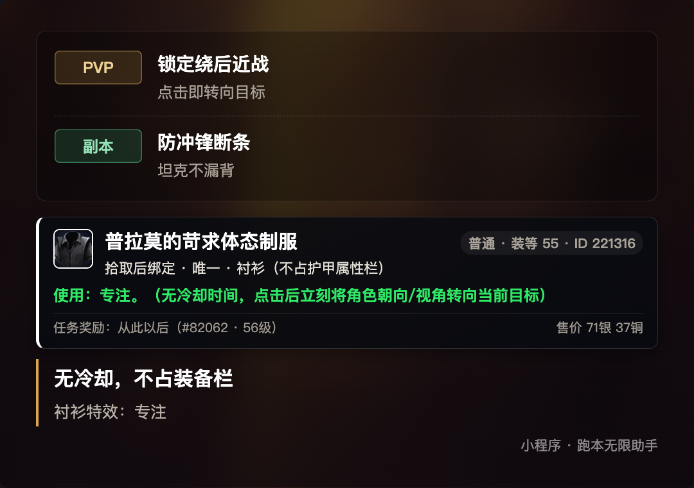

# 黑石深渊隐藏任务！对话拿三件神器

> 黑石深渊隐藏任务「从此以后」，只需对话即可获得三件神器：自动转向衬衫、留言路牌玩具、百分比回血干果。

## 隐藏任务触发

黑石深渊隐藏任务「从此以后」需要等级!!55!!级以上进入副本，在竞技场左边出门后，右转是**宝库傀儡**，后方小桥就是关键。

从桥上跳下，贴着悬崖飘到发红平台，与**沧桑的旅行者**对话即可完成任务。

## 跳桥路线技巧

天裔、牧师、工程可轻松飘落；无技能则需沿悬崖切线跳，背对悬崖逐步下挪，失误会掉入岩浆。

建议提前练习**缓落**手感，或组法师要缓落术。

## 旅行者标志

**旅行者标志**是精良玩具，冷却!!30!!分钟，放置后持续!!1!!分钟，可留言持续!!1!!小时，其他玩家可见。

可标记ADD、巡逻或提示道具，售价!!46银18铜!!。

- **旅行者标志**（精良 · 装等 60 · 拾取后绑定 · 唯一 · 物品 · 玩具 · 黑石深渊隐藏对话（沧桑的旅行者） · 售价 46银 18铜）
  - `使用：放置一个持续1分钟的旅行者印记。可以在标牌上写下信息，使其持续1小时，并对其他玩家可见。（30分钟冷却）`

## 混调干果

**混调干果**为优秀消耗品，战斗中可用，按比例恢复生命、怒气、能量或法力，冷却!!5!!分钟。

任务奖励!!3!!个，堆叠上限!!30!!，是保命底牌。

- **混调干果**（优秀 · 装等 33 · 拾取后绑定 · 堆叠上限 30 · 消耗品 · 其它 · 任务奖励：从此以后（#82062）×3 · 无限服无双倍经验条效果）
  - `使用：满满吃上一捧，弥补消磨在赶路上的时间！（5分钟冷却，法术：方便零嘴）`
  - `实测机制：战斗中可用，持续按比例恢复生命值及怒气、能量或法力值`
  - *“经典的葡萄干和花生……以及其他美味！”*

## 苛求体态制服

**普拉莫的苛求体态制服**是普通衬衫，不占护甲栏，使用后立即转向当前目标，无冷却。

PVP防绕后、副本防冲锋断条，售价!!71银37铜!!。

- **普拉莫的苛求体态制服**（普通 · 装等 55 · 拾取后绑定 · 唯一 · 衬衫（不占护甲属性栏） · 任务奖励：从此以后（#82062 · 56级） · 售价 71银 37铜）
  - `使用：专注。（无冷却时间，点击后立刻将角色朝向/视角转向当前目标）`

